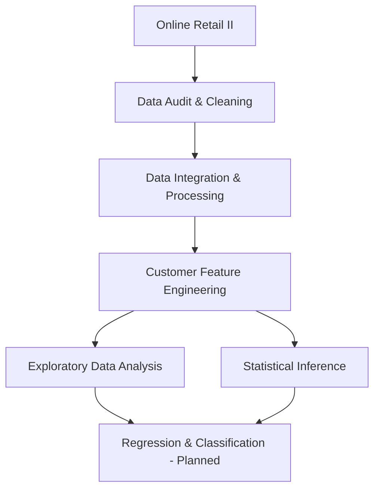
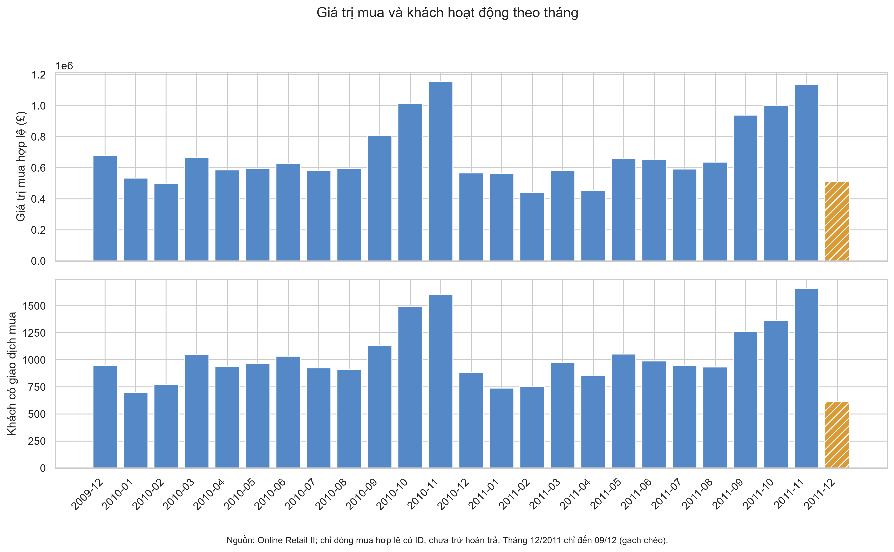

# Phân tích hành vi mua sắm thương mại điện tử

**E-commerce Customer Behavior Analysis**

Dự án thuộc học phần **INFO3020 – Nhập môn Khoa học dữ liệu**, sử dụng dữ liệu giao dịch thực tế của một nhà bán lẻ trực tuyến tại Anh để phân tích hành vi mua sắm, mức chi tiêu, tần suất giao dịch và xu hướng mua hàng theo thời gian.

Dự án triển khai quy trình khoa học dữ liệu từ thu thập, kiểm tra chất lượng và xử lý dữ liệu đến phân tích khám phá (EDA), trực quan hóa và kiểm định thống kê. Kết quả là nền tảng cho các mô hình dự báo chi tiêu và khả năng khách hàng quay lại mua hàng.

## 1. Mục tiêu nghiên cứu

- Khám phá phân phối chi tiêu, giá trị đơn hàng trung bình (AOV) và tần suất mua sắm.
- So sánh hành vi khách hàng giữa thị trường Anh và các thị trường quốc tế.
- Phân tích xu hướng mua hàng theo thời gian, mùa vụ và cuối tuần.
- Đánh giá mối liên hệ giữa các đặc trưng khách hàng và hành vi mua nhiều lần bằng phương pháp thống kê.
- Xây dựng cơ sở dữ liệu và đặc trưng nhất quán cho các bài toán dự báo trong giai đoạn tiếp theo.

## 2. Dataset

Dự án sử dụng **Online Retail II**, bộ dữ liệu giao dịch của một nhà bán lẻ trực tuyến tại Vương quốc Anh. Dữ liệu bao gồm cả khách hàng mua lẻ và mua buôn, giao dịch mua hàng và hóa đơn hủy/hoàn trả.

| Thuộc tính | Thông tin |
| --- | --- |
| Dataset | Online Retail II |
| Nguồn gốc | UCI Machine Learning Repository |
| Thời gian | 01/12/2009 – 09/12/2011 |
| Quy mô | 1.067.371 dòng dữ liệu, 8 cột |
| Đơn vị quan sát | Một dòng sản phẩm trong hóa đơn |
| Đơn vị tiền tệ | Bảng Anh (GBP) |
| Định dạng hỗ trợ | CSV, XLSX |
| Giấy phép của UCI | [CC BY 4.0](https://creativecommons.org/licenses/by/4.0/) |

### 2.1. Các trường dữ liệu gốc

| Cột | Mô tả |
| --- | --- |
| `Invoice` | Mã hóa đơn; tiền tố `C` biểu thị hủy/hoàn trả |
| `StockCode` | Mã sản phẩm |
| `Description` | Mô tả sản phẩm |
| `Quantity` | Số lượng sản phẩm trong dòng hóa đơn |
| `InvoiceDate` | Ngày và giờ giao dịch |
| `Price` | Đơn giá sản phẩm (GBP) |
| `Customer ID` | Mã định danh khách hàng |
| `Country` | Quốc gia của khách hàng |

### 2.2. Nguồn tải dữ liệu

- **Khuyến nghị:** [Online Retail II UCI – Kaggle (CSV)](https://www.kaggle.com/datasets/mashlyn/online-retail-ii-uci).
- **Nguồn gốc:** [Online Retail II – UCI (XLSX)](https://archive.ics.uci.edu/dataset/502/online+retail+ii).

Hai định dạng là các bản phân phối của cùng bộ dữ liệu, không cần tải cả hai. Pipeline ưu tiên CSV UTF-8; nếu không có CSV, chương trình đọc và hợp nhất hai sheet của file XLSX gốc.

Tham khảo [Data Dictionary](docs/data_dictionary.md) để xem định nghĩa đầy đủ các trường dữ liệu và [Data Sources](docs/data_sources.md) để xem nguồn, metadata và quy ước tích hợp.

## 3. Quy trình phân tích



| Thành phần | Nội dung |
| --- | --- |
| Data Audit & Cleaning | Kiểm tra schema, kiểu dữ liệu, missing values, bản ghi trùng, ngoại lai và tính nhất quán của giao dịch. |
| Data Integration | Kết hợp dữ liệu giao dịch với bảng tham chiếu quốc gia và lịch mùa vụ do dự án định nghĩa. |
| Feature Engineering | Tạo đặc trưng cấp khách hàng: Recency, Frequency, Monetary, AOV, tỷ lệ mua cuối tuần, tỷ lệ mua mùa cao điểm và tỷ lệ hóa đơn hủy. |
| EDA & Visualization | Phân tích thống kê mô tả, phân phối chi tiêu, khu vực thị trường, xu hướng theo tháng và tương quan giữa các biến. |
| Statistical Inference | Kiểm định giả thuyết, khoảng tin cậy, effect size, hiệu chỉnh Bonferroni, phân tích độ nhạy và thiết kế A/B Testing đề xuất. |

`monetary` là tổng giá trị các giao dịch mua hợp lệ, chưa trừ hoàn trả. `weekend_ratio` và `peak_month_ratio` được tính theo số hóa đơn mua, không theo số dòng sản phẩm. Notebook EDA và kiểm định thống kê sử dụng chung logic tạo hồ sơ khách hàng.

## 4. Cấu trúc thư mục

```text
ecommerce-behavior-analysis/
├── data/
│   ├── raw/                                # Dữ liệu gốc (tự tải)
│   └── processed/                          # Dữ liệu Parquet (tự sinh)
│       ├── retail_cleaned_w4.parquet
│       ├── retail_processed.parquet
│       ├── customer_profiles.parquet
│       └── customer_modeling_dataset.parquet
├── docs/
│   ├── data_dictionary.md                  # Từ điển dữ liệu
│   └── data_sources.md                     # Nguồn dữ liệu và metadata
├── notebooks/
│   ├── 01_data_audit_and_cleaning.ipynb       # Kiểm toán và làm sạch
│   ├── 02_exploratory_data_analysis.ipynb     # EDA và trực quan hóa
│   ├── 03_statistical_inference.ipynb         # Kiểm định thống kê
│   └── 04_classification_repeat_purchase.ipynb # Phân loại
├── reports/
│   ├── figures/                            # Biểu đồ EDA
│   ├── cleaning_log.csv                    # Nhật ký xử lý (tự sinh)
│   └── cleaning_log_w4.csv                 # Nhật ký kiểm toán (tự sinh)
├── src/
│   ├── __init__.py
│   ├── utils.py                            # Hàm kiểm toán dữ liệu
│   ├── pipeline.py                         # Nạp, làm sạch và tích hợp
│   ├── customer_features.py                # Đặc trưng cấp khách hàng (EDA)
│   └── classification_features.py          # Đặc trưng trước cutoff và nhãn 90 ngày
├── tests/
│   ├── test_data_contract.py                # Kiểm thử dữ liệu và đặc trưng
│   └── test_classification_contract.py      # Kiểm thử cutoff/preprocessor
├── .gitignore
├── requirements.txt
├── requirements-dev.txt
└── README.md
```

Các thư mục dữ liệu, file Parquet và nhật ký CSV được tạo hoặc tải về trên máy local; không cần có sẵn trong repository.

## 5. Cài đặt và chuẩn bị dữ liệu

### 5.1. Yêu cầu môi trường

- Python 3.11 (môi trường phát triển: Python 3.11.9).
- Git.
- VS Code với extension Python và Jupyter, hoặc Jupyter Notebook.

### 5.2. Clone repository

```powershell
git clone https://github.com/huybel2012/ecommerce-behavior-analysis.git
cd ecommerce-behavior-analysis
```

Nếu sử dụng một nhánh phát triển, chuyển sang nhánh tương ứng trước khi cài đặt. Ví dụ, sau khi nhánh `Dung` được đẩy lên GitHub:

```powershell
git switch Dung
```

### 5.3. Tạo môi trường ảo và cài đặt thư viện

Chạy các lệnh sau từ thư mục gốc của dự án (Windows PowerShell):

```powershell
py -3.11 -m venv .venv
.\.venv\Scripts\python.exe -m pip install -r requirements.txt
.\.venv\Scripts\python.exe -m pip check
```

Các thư viện chính: Pandas, NumPy, SciPy, Scikit-learn, Matplotlib, Seaborn, PyArrow, OpenPyXL và Jupyter.

Nếu đã có môi trường `.venv`, không cần tạo lại; sử dụng interpreter hiện có và bảo đảm các phiên bản thư viện khớp với `requirements.txt`.

### 5.4. Tải và đặt dataset

1. Tải dataset từ một trong hai đường dẫn ở [mục 2.2](#22-nguồn-tải-dữ-liệu).
2. Giải nén file tải về nếu cần.
3. Tạo thư mục chứa dữ liệu:

   ```powershell
   New-Item -ItemType Directory -Force -Path "data/raw", "data/processed" | Out-Null
   ```

4. Đặt **một trong hai file** vào thư mục `data/raw/` với đúng tên sau:

   ```text
   data/raw/online_retail_II.csv
   ```

   hoặc:

   ```text
   data/raw/online_retail_II.xlsx
   ```

File XLSX phải chứa hai sheet `Year 2009-2010` và `Year 2010-2011`. Không cần chỉnh sửa nội dung hoặc tên cột của dataset. Dữ liệu thô và dữ liệu đã xử lý không được commit lên GitHub.

## 6. Hướng dẫn chạy dự án

Tất cả lệnh terminal được thực hiện từ thư mục gốc của repository. Trong VS Code, chọn Python interpreter và notebook kernel trỏ tới `.venv\Scripts\python.exe`.

### Bước 1. Data Audit & Cleaning

Mở [01_data_audit_and_cleaning.ipynb](notebooks/01_data_audit_and_cleaning.ipynb), chọn **Restart Kernel & Run All**.

Kết quả:

- `data/processed/retail_cleaned_w4.parquet`
- `reports/cleaning_log_w4.csv`

### Bước 2. Chạy Data Pipeline

```powershell
.\.venv\Scripts\python.exe -m src.pipeline
```

Pipeline nạp dữ liệu gốc, sử dụng cùng logic làm sạch, tích hợp các bảng tham chiếu và lưu:

- `data/processed/retail_processed.parquet`
- `reports/cleaning_log.csv`

Có thể chạy pipeline độc lập mà không cần thực thi notebook 01 trước. Tuy nhiên, cần chạy notebook 01 nếu muốn xem báo cáo kiểm toán và phân tích ngoại lai.

### Bước 3. Exploratory Data Analysis

Mở [02_exploratory_data_analysis.ipynb](notebooks/02_exploratory_data_analysis.ipynb), chọn **Restart Kernel & Run All** để tạo hồ sơ hành vi khách hàng trong bộ nhớ, thống kê mô tả và các biểu đồ tại `reports/figures/`.

### Bước 4. Statistical Inference

Mở [03_statistical_inference.ipynb](notebooks/03_statistical_inference.ipynb), chọn **Restart Kernel & Run All** để thực hiện ba kiểm định thống kê và lưu `data/processed/customer_profiles.parquet`.

Notebook 02 và 03 đều yêu cầu `retail_processed.parquet` do pipeline tạo. Khi thay đổi dữ liệu gốc hoặc logic xử lý, chạy lại pipeline trước khi thực thi hai notebook này.

### Bước 5. Classification (W11)

Mở [04_classification_repeat_purchase.ipynb](notebooks/04_classification_repeat_purchase.ipynb), chọn **Restart Kernel & Run All**. Notebook tự chạy lại pipeline từ dữ liệu gốc, ghi bảng `customer_modeling_dataset.parquet` và không tái sử dụng cache cũ. Có thể chỉ tạo dataset bằng `python -m src.classification_features` từ thư mục gốc.

- Cutoff: 01/09/2011 00:00; nhãn mua lại trong `[cutoff, cutoff + 90 ngày)`, kết thúc loại trừ lúc 00:00 ngày 30/11/2011.
- Mốc quan sát lấy từ timestamp cuối của nguồn giao dịch gốc trước khi làm sạch. Đây là kiểm tra độ phủ thời gian bảo thủ, giả định file nguồn đầy đủ và liên tục; nếu nguồn bị thiếu dòng/ngày thì vẫn cần kiểm chứng nguồn.
- Cắt theo timestamp gốc rồi mới gom hóa đơn trong lịch sử; cùng cặp customer_id + invoice sau cutoff không tính là đơn mới nếu đã xuất hiện trước cutoff. Cờ mùa/cuối tuần lấy theo thời điểm bắt đầu hóa đơn đã quan sát.
- Địa lý: mode của country_original đã quan sát trước cutoff; Unknown nếu không có quốc gia hợp lệ, không dùng quốc gia nội suy toàn kỳ.
- P1: ba cutoff train 01/03, validation 01/06, test 01/09/2011, nhãn 90 ngày không chồng lấn. CV phân tầng trong train chọn ROC-AUC cao nhất (hòa: Average Precision, rồi tên). Fit train, chọn F1 threshold trên validation, giữ nguyên model và threshold khi test. Không dùng test để chọn lại mô hình.
- Khách có thể lặp qua các snapshot (dự báo khách đã biết), không đại diện cold-start; test tháng 9 đã được xem trong P0 nên kết quả mới là hồi cứu theo thời gian, không phải holdout chưa từng tiếp cận.
- Notebook 04 tạo thêm `customer_modeling_train.parquet`, `customer_modeling_validation.parquet`, `customer_modeling_test.parquet`, bảng CV/metric/importance trong `reports/` và biểu đồ 05, 06. Permutation Importance tính trên validation, không chọn lại feature.

### Bước 6. Kiểm thử

```powershell
.\.venv\Scripts\python.exe -m pip install -r requirements-dev.txt
.\.venv\Scripts\python.exe -m pytest -q
```

Bộ test kiểm tra dữ liệu đầu vào, feature, preprocessor, ranh giới cutoff/horizon, chống leakage và tái tạo dataset. Test Parquet dùng PyArrow và dữ liệu nhỏ tự tạo. Chạy lại toàn bộ notebook trên dữ liệu thật trước khi nghiệm thu; không coi test giả lập là kết quả mô hình thực tế.

## 7. Kết quả phân tích hiện tại

### 7.1. Dữ liệu sau xử lý

Các giá trị tham chiếu từ lần nghiệm thu P0 trên bản CSV Online Retail II gốc; tỷ lệ khớp metadata quốc gia có thể thay đổi sau P1, lấy số mới từ pipeline chạy lại:

| Chỉ số | Kết quả |
| --- | ---: |
| Dòng dữ liệu gốc | 1.067.371 |
| Dòng dữ liệu sau làm sạch | 794.437 |
| Số cột sau tích hợp | 21 |
| Khách hàng có ít nhất một đơn mua hợp lệ | 5.853 |
| Tỷ lệ khớp bảng quốc gia | 99,71% |
| Tỷ lệ khớp lịch mùa vụ | 100% |

### 7.2. Trực quan hóa dữ liệu



*Biểu đồ theo tháng chỉ tính giao dịch mua hợp lệ; tháng 12/2011 chưa có đủ dữ liệu cả tháng.*

Các biểu đồ khác:

- [Phân phối tổng chi tiêu khách hàng](reports/figures/01_monetary_distribution.png)
- [Mức chi tiêu theo khu vực thị trường](reports/figures/02_spending_by_region.png)
- [Ma trận tương quan hành vi mua sắm](reports/figures/04_behavior_correlation_heatmap.png)

- Notebook 01: sáu chiều chất lượng (điểm rubric nội bộ), so sánh dòng có/thiếu ID và kiểm tra timestamp đơn hàng. Notebook 02: thống kê location/spread/shape, Pearson và Spearman, thống kê theo khu vực/thị trường. Unknown được tách khỏi Other_International; điểm Accuracy không phải phép đo độ đúng thực tế.
- [Đánh giá classification theo thời gian](reports/figures/05_classification_evaluation.png) và [Permutation Importance](reports/figures/06_classification_feature_importance.png) được cập nhật khi chạy notebook 04. Không dùng số liệu P0 như kết quả P1.

### 7.3. Kiểm định thống kê

Ba giả thuyết được kiểm định hai phía với mức ý nghĩa 5%, có hiệu chỉnh Bonferroni cho ba phép kiểm định chính.

| Câu hỏi nghiên cứu | Phương pháp | Kết quả chính |
| --- | --- | --- |
| Phân phối AOV giữa khách quốc tế và UK có khác nhau không? | Mann–Whitney U | Có bằng chứng khác biệt; trung vị AOV của khách quốc tế cao hơn 128,79 GBP. |
| Nhóm mua chủ yếu trong tháng 9–12 và nhóm còn lại có mức chi tiêu khác nhau không? | Welch's t-test trên `log1p(monetary)` | Có bằng chứng khác biệt trên thang log; nhóm mua chủ yếu trong tháng 9–12 có trung bình log chi tiêu thấp hơn. |
| Thị trường có liên hệ với việc mua nhiều lần trong kỳ quan sát không? | Pearson Chi-square | Chưa đủ bằng chứng thống kê về mối liên hệ. |

Phân tích độ nhạy sử dụng cửa sổ quan sát 365 ngày để giảm ảnh hưởng của thời lượng quan sát. Chi tiết khoảng tin cậy, effect size, p-value và thiết kế A/B Testing được trình bày trong notebook 03.

## 8. Hướng phát triển

| Giai đoạn | Trạng thái |
| --- | --- |
| Thu thập, kiểm toán và xử lý dữ liệu (W1–W5) | Đã triển khai |
| Thống kê mô tả và trực quan hóa (W6–W7) | Đã triển khai |
| Statistical Inference & A/B Testing (W9) | Đã triển khai kiểm định và thiết kế thí nghiệm đề xuất |
| Regression Analysis (W10) | Kế hoạch dự báo chi tiêu trong 90 ngày tiếp theo |
| Classification (W11) | Đã xây dựng temporal evaluation, model selection và permutation importance; chạy lại notebook 04 để có kết quả mới |
| Ethics & Bias (W12) | Kế hoạch đánh giá giới hạn và sai lệch mô hình |

Các mô hình dự báo tương lai cần xây dựng đặc trưng từ dữ liệu trước mốc dự báo, chia tập theo thời gian và kiểm tra data leakage. Hồ sơ khách hàng toàn kỳ hiện tại phục vụ phân tích mô tả, không sử dụng trực tiếp làm đầu vào dự báo tương lai.

## 9. Giới hạn nghiên cứu

- Dataset phản ánh một nhà bán lẻ trong giai đoạn 2009–2011, không đại diện cho toàn bộ thị trường thương mại điện tử.
- Loại giao dịch thiếu Customer ID có thể gây sai lệch chọn mẫu; khách mua buôn có thể ảnh hưởng đến phân phối chi tiêu.
- Nhóm khu vực, lịch mùa vụ và vùng vận chuyển là các quy ước phân tích, không phải số liệu chi phí vận chuyển hay dữ liệu khuyến mại thực tế.
- Kiểm định thống kê trên dữ liệu quan sát không chứng minh quan hệ nhân quả. Dataset không chứa phân nhóm thử nghiệm ngẫu nhiên; A/B Testing hiện là thiết kế đề xuất.

## Tài liệu tham khảo

Chen, D. (2012). *Online Retail II* [Dataset]. UCI Machine Learning Repository. [https://doi.org/10.24432/C5CG6D](https://doi.org/10.24432/C5CG6D).
